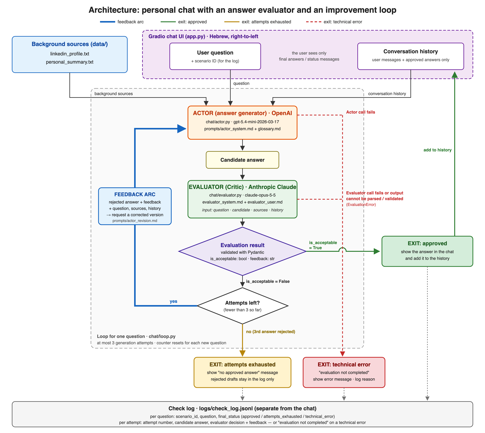

# Architecture

Source: [`architecture.svg`](architecture.svg). It is rendered to PNG with headless Chrome:
`"/Applications/Google Chrome.app/Contents/MacOS/Google Chrome" --headless=new --hide-scrollbars --force-device-scale-factor=2 --window-size=1600,1430 --screenshot=docs/architecture.png docs/architecture.svg`

## How to read it

- **Two providers.** The Actor is an OpenAI model (`gpt-5.4-mini-2026-03-17`) and generates every candidate answer. The Evaluator is Anthropic's Claude (`claude-opus-5-5`) and checks each of them: the first answer and every corrected version. Each role has its own API call, prompts and API key (`OPENAI_API_KEY`, `ANTHROPIC_API_KEY`). A model from a different provider judges the Actor, so the two roles do not share one model's blind spots.

- **Inputs.** Every Actor call gets the background sources, the displayed conversation history and the user question. The evaluator gets the same material plus the candidate answer.
- **Evaluation result.** Claude returns JSON through structured output (`output_config.format` with the Evaluation schema). The application then validates it against the `Evaluation` Pydantic model. Only the validated `is_acceptable` field decides the next step.
- **Feedback arc** (thick blue). When an answer is rejected and attempts remain, the rejected answer and the evaluator's feedback go back to the Actor together with the question, the background and the history. The corrected version is evaluated again.
- **Exit paths:**
  - **Approved:** the answer is shown and added to the history.
  - **Attempts exhausted:** after the third rejected answer, a fixed message is shown. Rejected answers are never shown.
  - **Technical error:** a failed model call, or evaluator output that cannot be parsed or validated. Handling stops, and the log records that the evaluation was not completed.
- **Check log.** All drafts, decisions and feedback go to the check log, never to the displayed chat. When a question ends without an approved answer, it is left out of the history passed to the models.
